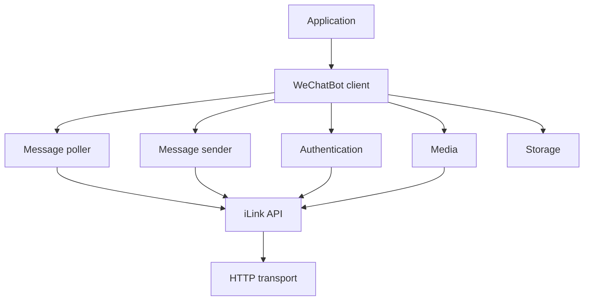

# Node.js SDK architecture

The Node.js implementation lives in [`nodejs/`](../nodejs/). Its public entry point is `nodejs/src/index.ts`.

| Directory | Responsibility |
| --- | --- |
| `core/` | Client orchestration, events, and errors |
| `transport/` | HTTP requests, timeouts, and retries |
| `protocol/` | iLink requests and wire types |
| `auth/` | QR login and credentials |
| `messaging/` | Polling, sending, typing, and context tokens |
| `media/` | CDN upload, download, encryption, and media helpers |
| `message/` | Message parsing and construction |
| `middleware/` | Message middleware |
| `storage/` | File, memory, and custom storage interface |
| `logger/` | Structured logging |

The [protocol reference](protocol.md) describes the wire API. The [Node.js SDK guide](../nodejs/README.md) documents the public API.
